  

 

> Je fabrique des **sites et des applications web, du design à la mise en ligne**, et je m'amuse avec l'**IA qui tourne en local** et le **mobile iOS**. Étudiant à Epitech, je préfère les projets concrets : un site pour un artisan, un outil qui sert vraiment, un jeu qu'on peut lancer.

<b>🇬🇧 In English</b>

 

I build **websites and web apps, from design to deployment**, and I enjoy playing with **locally-run AI** and **iOS**. As an Epitech student, I prefer concrete projects: a site for a local business, a tool people actually use, a game you can launch.

 

## En ce moment

- 🧹 Je remets au propre un projet legacy à Epitech : carte du code, registre de dette technique, tests et CI avant tout refactoring
- 🎮 J'ai sorti **Pokaju**, un petit jeu de rôle en Java, jouable via un `.jar`
- 🌐 Je fais évoluer mon [portfolio 3D](https://portfolio-mahe.vercel.app/) avec une admin en ligne pour gérer mes projets

 

## Ce que je construis

<table>
<tr>
<td width="50%" valign="top">

### 🧠 IA locale
**[J.A.R.V.I.S](https://github.com/MaheCourdurie/Jarvis)** 
Assistant personnel qui tourne chez moi : modèle fine-tuné, actions Gmail et Calendar, bot Discord. 
`Python` · `FastAPI` · `Ollama` · `MLX`

</td>
<td width="50%" valign="top">

### 🌐 Web, pour de vrais clients
**[MAKI Paysage](https://maki-paysagiste.fr)** · site vitrine d'un paysagiste 
**[Spigalou](https://www.spigalou.fr/)** · site d'un food truck végétarien 
**[Roue aléatoire](https://choix.vercel.app/)** · des listes à partager, un spin pour décider 
`React` · `Vite` · `Tailwind` · `Supabase`

</td>
</tr>
<tr>
<td width="50%" valign="top">

### 🎮 Jeux
**[Pokaju](https://github.com/Saachiii/pokadju/releases/latest)** 
RPG façon Pokémon : 493 créatures, combats, capture, Pokédex. À télécharger et lancer. 
`Java` · `libGDX`

</td>
<td width="50%" valign="top">

### 📊 Data et apps
**[Tardis](https://github.com/MaheCourdurie/Tardis)** · analyse et prédiction des retards de trains 
**[E-Todo](https://github.com/MaheCourdurie/E-Todo-Project)** · tâches partagées, mon premier projet Epitech 
`Python` · `scikit-learn` · `TypeScript` · `Docker`

</td>
</tr>
</table>

 

## Compétences

  

 

## Me trouver

**Portfolio** · [portfolio-mahe.vercel.app](https://portfolio-mahe.vercel.app/)  
**Email** · [mahe.courdurie@epitech.eu](mailto:mahe.courdurie@epitech.eu)  
**Langues** · français, English
